<div align="center">


# BASE

**Strict focus. One task at a time.**

A task manager that decides what you should work on next, and then keeps you on it.
Projects, lists and tasks go in; a priority score, a timed plan for today and a
distraction-free focus screen come out.

React 19 · TypeScript · Vite · Firebase · Vercel · installable as an app on phone, tablet and desktop

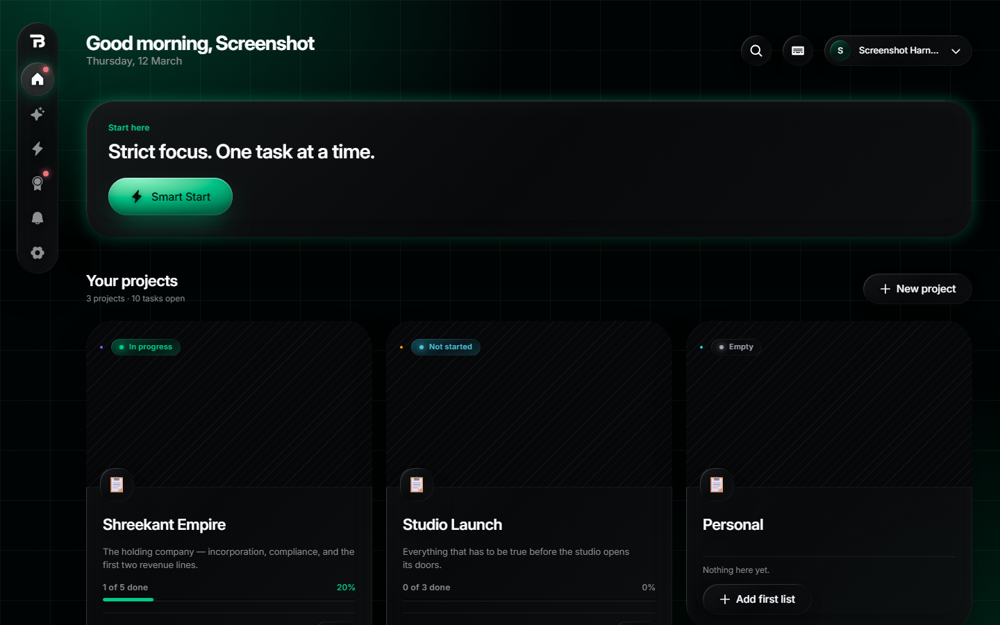

</div>

---

## Contents

- [What it does](#what-it-does)
- [Screenshots](#screenshots)
- [Quick start](#quick-start)
- [Deploying your own copy](#deploying-your-own-copy)
- [Optional features](#optional-features)
- [Project layout](#project-layout)
- [Commands](#commands)
- [Documentation](#documentation)
- [Contributing](#contributing)
- [License](#license)

## What it does

Most to-do apps are good at *storing* tasks. BASE is built around the part that comes after:
choosing one, and doing it.

| | |
|---|---|
| **Projects → lists → tasks → subtasks** | Board or list view, drag and drop by mouse, finger or keyboard, tags, a money value per list, and "waiting on" links between tasks. |
| **A priority score for every task** | Seven capped factors: importance, emergency, deadline, overdue, bottleneck, times avoided and duration. Normally they add up. When a task gets close to its latest possible start, they multiply, so a task that is late *and* blocking others rises above one that is merely important. A small task that is holding up a big one inherits its urgency. |
| **Smart Start** | One button builds today's queue from the highest scores that fit in your hours. A blocked task only comes in together with what it is waiting on, prerequisites first. |
| **Select → Deadlines → Focus** | Pick today's tasks, give each a time box inside your work window, then work through them one at a time with a timer, subtasks, +5 / +15 minutes, and a "defer" that is counted against the task. |
| **Deadlines that move themselves** | If a prerequisite's deadline moves past a task that depends on it, that task's deadline is pushed back too. Deadlines are only ever pushed later, never pulled earlier, and a banner tells you what moved. |
| **Repeating tasks** | Any iCalendar repeat rule ("last Friday of every month"). Each date is counted from the first one, so a task on the 31st comes back to the 31st after a short month. |
| **Google Calendar sync** | Each task with a deadline becomes a block of work in your calendar, repeats included, synced in batches. |
| **Push reminders** | A notification at the moment work has to *start* to finish on time, with a 5-minute snooze. |
| **Share links** | Share a task, list or project as a read-only list, a live client view (progress, budget, who is working on what right now), or an outsourcing board where people claim and hand in tasks. A link can expire. |
| **Trash and Archive** | Deleting is soft: 30 days in the Trash, restorable, with every link cleaned up. Archiving puts a finished project away for good without losing it. |
| **AI assistant** | Chat with an assistant that can read and change your tasks, with a Revert button for every turn it made changes in. Runs on Google Gemini, or on a local model on your own computer through the optional companion program (see below). |
| **Keyboard first** | Ctrl+K command palette, shortcuts you can rebind. |
| **Works offline, installs like an app** | A service worker caches the whole app. An update waits until you tap the banner. |
| **Admin panel** | The owner account sees every account and chooses which ones may use the assistant, and on whose key. |

A longer tour, with how each part works, is in [docs/FEATURES.md](docs/FEATURES.md).

## Screenshots

| | |
|---|---|
| 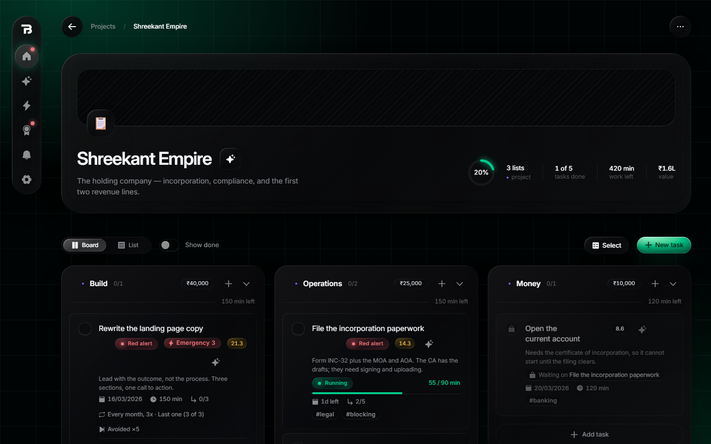 **Project board.** Lists, scores, deadlines, "waiting on" | 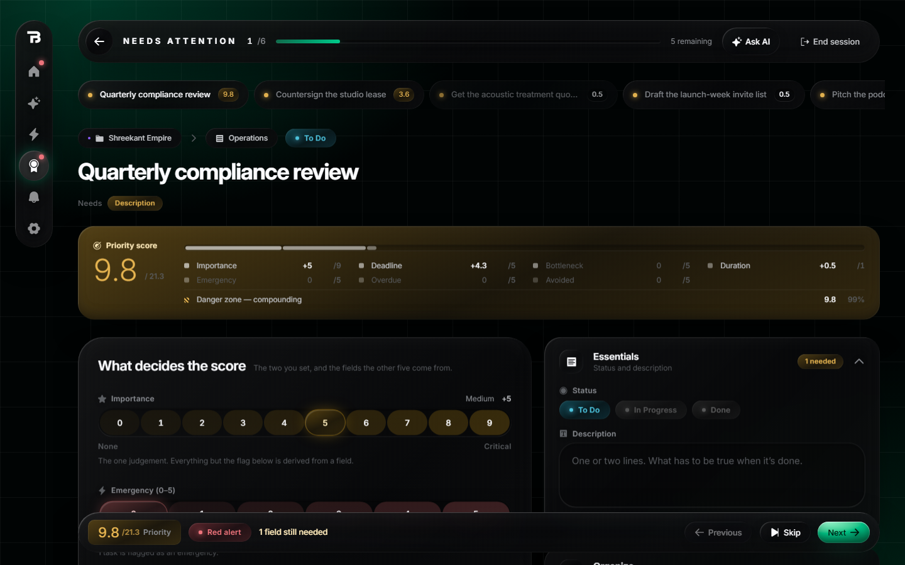 **Needs attention.** The score and what it is made of |
| 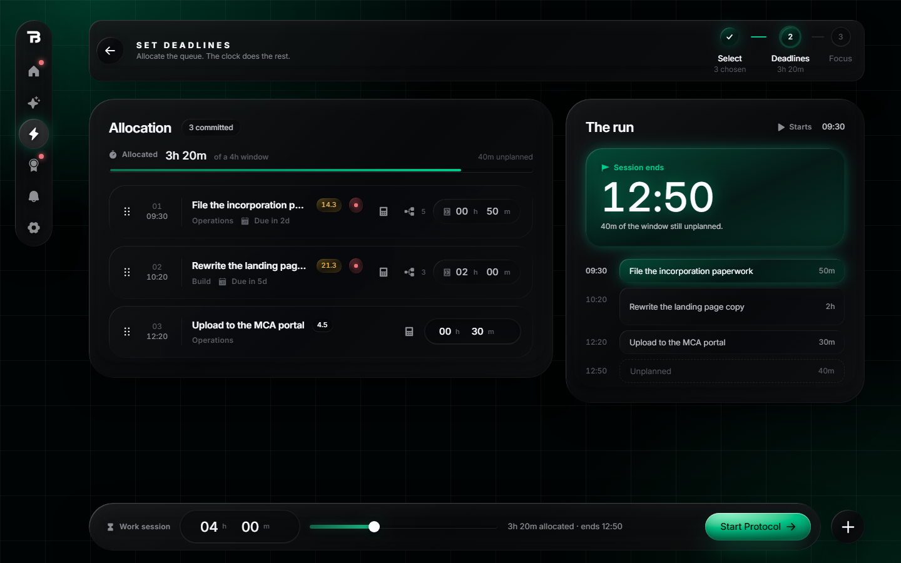 **Set deadlines.** Time-box today's queue | 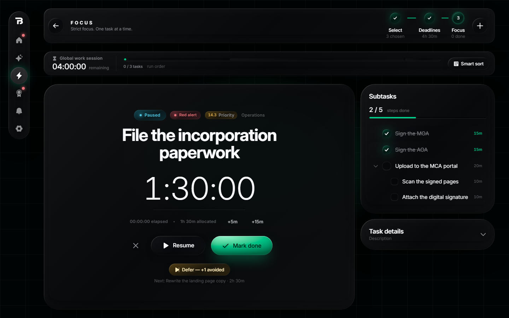 **Focus.** One task, one timer |
| 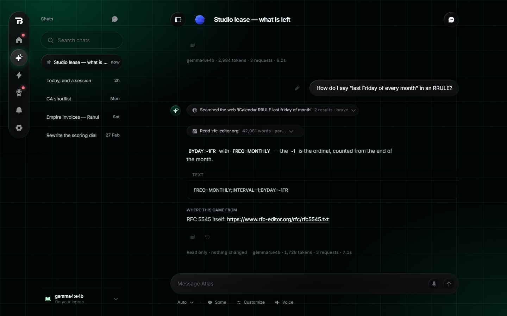 **Assistant.** Chats, tool calls, sources | 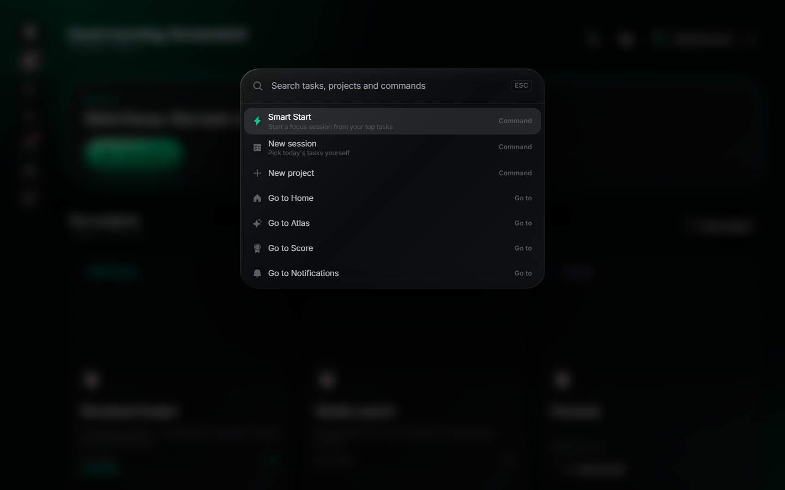 **Ctrl+K.** Find anything, run anything |
| 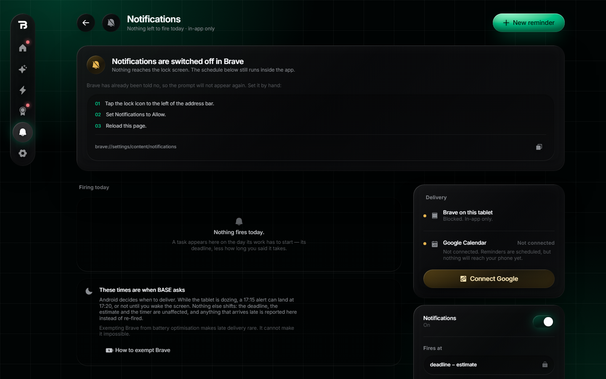 **Notifications.** Push, Calendar, reminders | 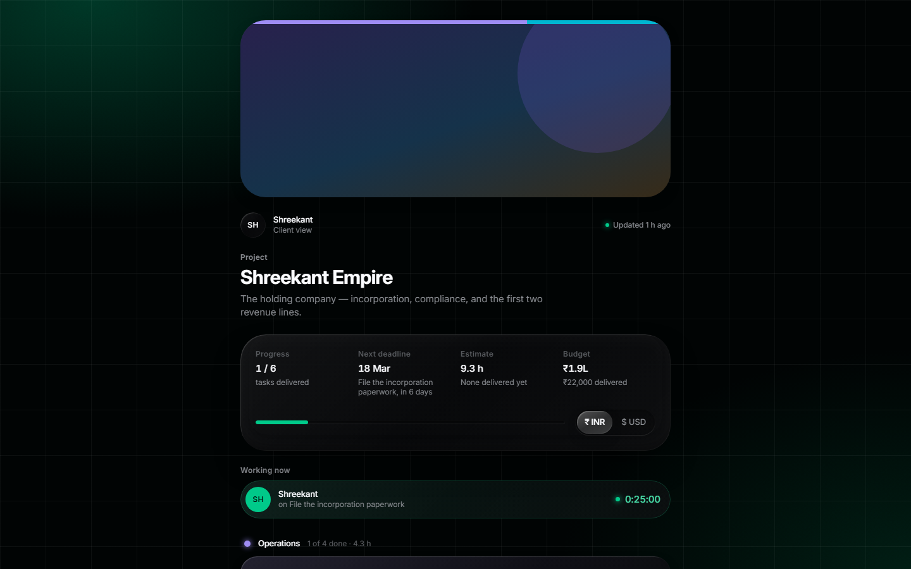 **Client view.** A live share link |
| 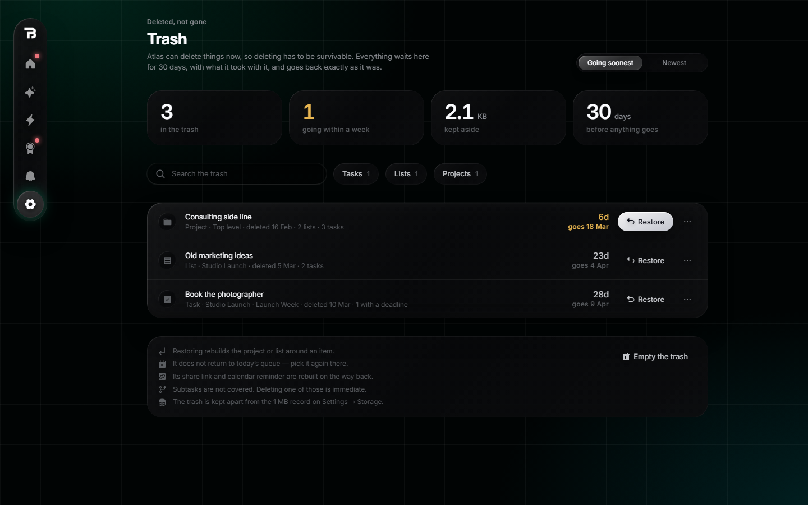 **Trash.** 30 days to change your mind | 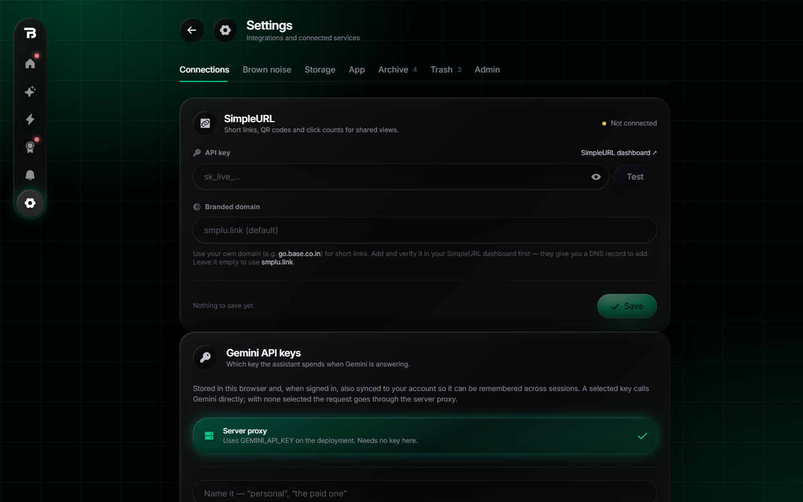 **Settings** |

<p align="center">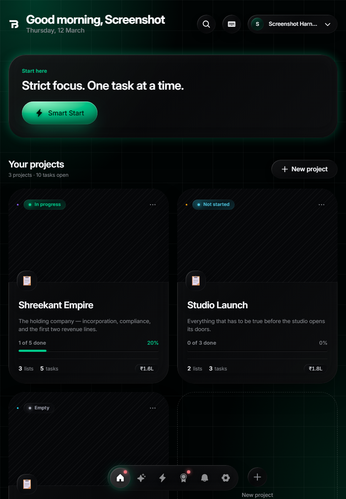</p>

*All screenshots show the built-in test data, not a real account.*

## Quick start

You need **Node.js 22 or newer** (24 recommended) and a free **Firebase** project.

```bash
git clone https://github.com/Shreekant121/Official_The_BASE_TODO.git
cd Official_The_BASE_TODO
npm install
cp .env.example .env        # then fill in the six VITE_FIREBASE_* values
npm run dev                 # http://localhost:5173
```

Setting up Firebase takes about ten minutes:

1. Create a project at [console.firebase.google.com](https://console.firebase.google.com).
2. **Authentication → Sign-in method →** turn on **Email/Password**.
3. **Firestore Database → Create database** (production mode, any region).
4. **Project settings → Your apps → Add app → Web.** Copy the six config values into `.env`.
5. **Make yourself the admin.** Put your own email address in two places: `OWNER_EMAIL` in
   `src/lib/adminAccess.ts`, and `isAdmin()` near the top of `firestore.rules`.
   `npm test` fails if the two don't match.
6. **Publish the security rules.** Firestore → Rules → paste in `firestore.rules` → Publish.
   Or run `npx firebase-tools deploy --only firestore` after setting your project id in
   `.firebaserc`.

Open the app, sign up, and you're in. To get the admin panel, verify your email when the
app asks. The longer version, including every optional feature, is
[docs/SETUP.md](docs/SETUP.md).

> `npm run dev` serves the app only. Features that need the server functions in `api/`
> (the hosted Gemini key, Google Calendar's long-lived connection, push) need
> `npm run dev:full`, which runs `vercel dev`.

## Deploying your own copy

BASE is made for **Vercel**: the app is static, and `api/` is a set of Vercel serverless
functions.

1. Push your copy to GitHub and **import it** at [vercel.com/new](https://vercel.com/new).
   Vercel detects Vite; the defaults are right.
2. Under **Settings → Environment Variables**, add the six `VITE_FIREBASE_*` values, plus
   whatever the optional features below need.
3. Deploy.

Or from your computer: `npx vercel --prod`.

## Optional features

Each one is off until you add its settings. The app works without any of them.
[`.env.example`](.env.example) explains every variable in detail.

| Feature | What to set | Where it runs |
|---|---|---|
| **AI assistant** | `GEMINI_API_KEY`, `FIREBASE_SERVICE_ACCOUNT` | `api/chat.ts`, `api/models.ts` |
| **Google Calendar** | `VITE_GOOGLE_CLIENT_ID`, `GOOGLE_CLIENT_ID`, `GOOGLE_CLIENT_SECRET`, `FIREBASE_SERVICE_ACCOUNT` | `api/google-connect.ts`, `api/refresh-token.ts` |
| **Push reminders** | `VITE_VAPID_PUBLIC_KEY`, `VAPID_PRIVATE_KEY`, `VAPID_SUBJECT`, `CRON_SECRET`, and a cron that calls `/api/push-fire` every minute | `api/push-fire.ts` |
| **Local AI (Atlas)** | `VITE_ATLAS_URL` | a companion program on your own computer |

**Who gets the assistant.** The owner (the admin email from step 5) always uses the server's
`GEMINI_API_KEY`. Every other account starts with the assistant off. The owner switches it on
per account in the Admin panel, either on that person's own Gemini key (they paste it in
**Settings**) or on the shared server key. The Gemini key never reaches the browser; the server
checks every request against those switches.

**`FIREBASE_SERVICE_ACCOUNT` is an admin key.** It gets past every security rule. Keep it in
Vercel's environment variables and your local `.env`, never in the code. `.gitignore` already
leaves `.env` out.

**About Atlas.** The chat can also run on a local model (through [Ollama](https://ollama.com))
on your own computer, reached from your phone or tablet over [Tailscale](https://tailscale.com).
That companion program, *Atlas*, is a separate project and is **not in this repository**. With
`VITE_ATLAS_URL` unset, the assistant simply uses Gemini. This repository does include the other
half: `npm run mcp` runs BASE as an [MCP](https://modelcontextprotocol.io) server, so any
MCP-capable agent can read and edit your tasks through the app's own logic.

## Project layout

```
src/
  pages/        one file per screen
  components/   the pieces screens are made of
  ui/           the design system: glass surfaces, tokens, motion, icons
  store/        Zustand stores: tasks, trash, archive, UI state
  lib/          the logic, mostly pure and tested: scoring, Smart Start,
                recurrence, deadline maths, deletion, sync, sharing...
    agent/      the assistant's tools and model plumbing
api/            Vercel serverless functions
server/         server code bundled into api/_lib/ by `npm run build:push`
mcp/            BASE as an MCP server (`npm run mcp`)
scripts/        build steps, the screenshot harness, the test fixture
design-system/  the design reference the UI was built from (not imported)
public/         icons, manifest, service worker
firestore.rules the lock on everyone's data
```

How the parts fit together, and why several of them look the way they do, is in
[docs/ARCHITECTURE.md](docs/ARCHITECTURE.md).

## Commands

```bash
npm run dev          # the app, with hot reload
npm run dev:full     # the app plus api/ functions (vercel dev)
npm run build        # production build into dist/
npm test             # unit tests (Vitest)
npm run lint         # ESLint, zero warnings allowed
npm run typecheck    # TypeScript
npm run verify       # all four above side by side, then screenshots if a screen could change
npm run shots        # photograph every screen and compare with the baselines
npm run shots:update # take new baselines (run once after cloning)
npm run build:push   # re-bundle server/ into api/_lib/ after changing it
npm run mcp          # BASE as an MCP server
```

## Documentation

- [docs/SETUP.md](docs/SETUP.md): Firebase, Vercel and every optional feature, step by step
- [docs/FEATURES.md](docs/FEATURES.md): a tour of each screen and the ideas behind it
- [docs/ARCHITECTURE.md](docs/ARCHITECTURE.md): how the code is put together
- [CONTRIBUTING.md](CONTRIBUTING.md): how to make a change and get it merged
- [SECURITY.md](SECURITY.md): how to report a vulnerability

## Contributing

Issues and pull requests are welcome. Please read [CONTRIBUTING.md](CONTRIBUTING.md) first.
The short version: run `npm run verify` before you open a pull request, and if you changed
how a screen looks, attach a before and after.

## License

[MIT](LICENSE). Use it, change it, ship it; keep the copyright notice.
